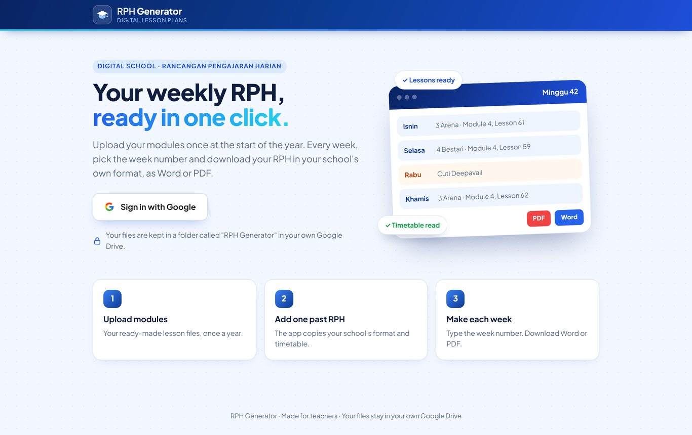
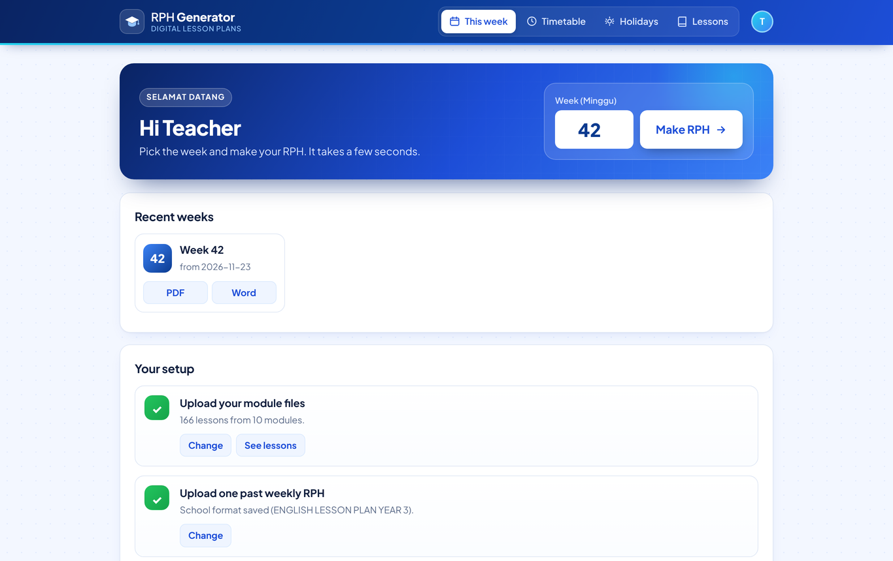
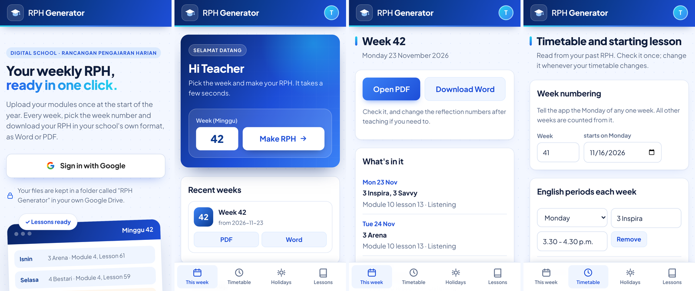

# RPH Generator (web app)

Teachers upload their module files and one past weekly RPH once a year. Every week they type the week number and download that week's RPH (Word and PDF) in their school's own format. Works on a laptop or a phone.

## How it works

1. **Modules**: the ready-made lesson files (e.g. MODULE 1 to 10, .doc or .docx) are read into a lesson list.
2. **Past RPH**: one week the teacher already made (e.g. M41.docx). The app keeps the school header and lesson table design, and reads the timetable, class names, reflection lines and which lesson each class is up to.
3. **Each week**: every class moves on one lesson per English period, in module order. Classes with the same lesson on the same day share one table. Holidays are skipped and get a holiday page.

Each teacher's files are kept in an **"RPH Generator" folder in their own Google Drive** (`drive.file` access: the app can only see files it created). The server keeps nothing, so a free server that sleeps or restarts loses nothing.

## Run it on one laptop (no Google sign-in)

```
pip install -r requirements.txt
python app.py            # open http://localhost:5000
```
Without `GOOGLE_CLIENT_ID` the app runs for one user and keeps files in `./data`. LibreOffice must be installed for .doc files and PDFs.

## Put it online (free)

See [DEPLOY.md](DEPLOY.md).




